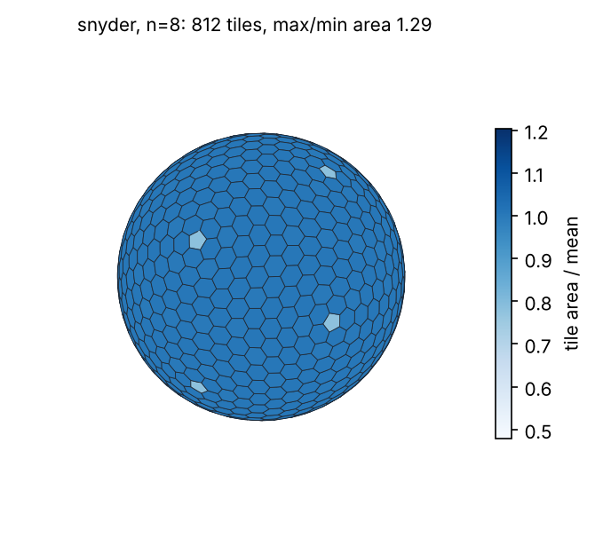
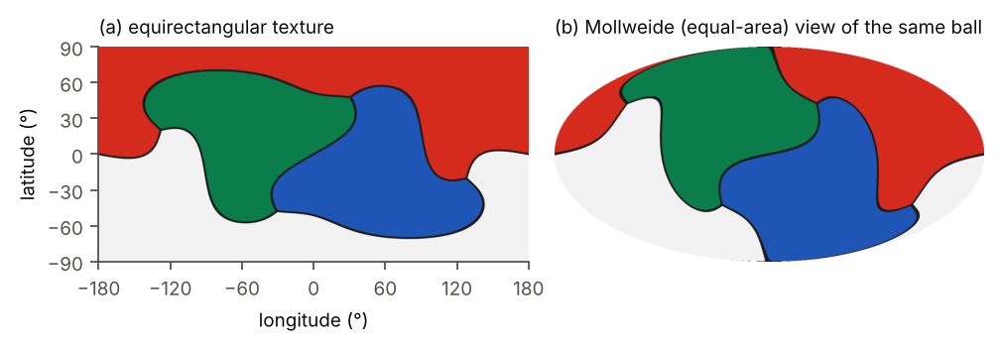
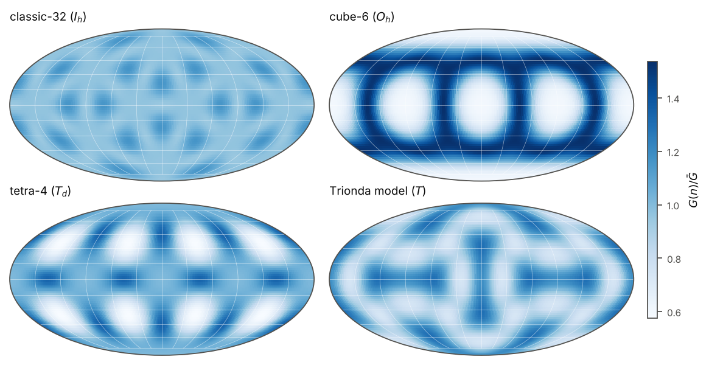
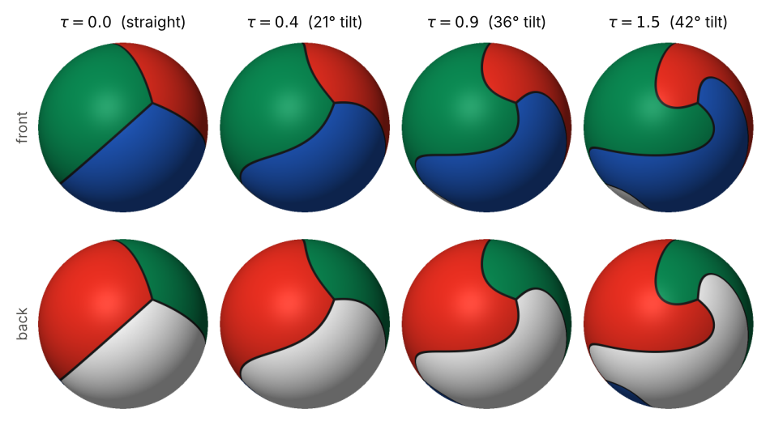

# Trionda Soccer Ball Generator

https://www.scientificamerican.com/article/the-surprising-math-and-physics-behind-the-2026-trionda-world-cup-soccer-ball/













## Ball types, matplotlib plots

Panels are assigned per pixel from a polyhedron description (`balls.py`), so there is no flood fill, no leaking and uniform seam
width everywhere on the sphere. Needs only `numpy`, `pillow` and `matplotlib`.

```bash
python gen_ball.py --list                       # available ball types
python gen_ball.py panel-6 -s 2048 -o p6.png    # texture for any type (same convention as gen_texture.py)
python gen_ball.py classic-32 --pentagon-color blue --bg-color white --edge-color black
python gen_ball.py panel-20 --palette viridis   # every panel its own colour

python make_sprites_mpl.py panel-8 4 -s 128 -o sprites/p8       # sprite sheet, no PyVista
python make_sprites_mpl.py examples/b-and-w.png 4 -o sprites/b  # existing textures work too
python view_ball.py panel-14                    # interactive matplotlib viewer with sliders

python plot_ball.py geometry    panel-14 -o geo.png   # 3D panels + seams
python plot_ball.py projections classic-32 -o proj.png# equirectangular + Tissot circles, Mollweide, 2 views
python plot_ball.py analysis    panel-6  -o ana.png   # panel areas, seam density vs latitude, metrics
python plot_ball.py compare     -o cmp.png            # all types side by side
python plot_ball.py gallery     -o gallery.png
python ball_stats.py                                  # metrics table
python -m pytest tests
```

| Type | Layout |
|------|--------|
| `classic-32`, `-red`, `-retro` | truncated icosahedron, 12 pentagons + 20 hexagons |
| `panel-6` | 6 swirled panels (cube topology) |
| `panel-8` | 8 twisted panels (octahedron), two alternating colours |
| `panel-12` | 12 pentagons (dodecahedron) |
| `panel-14`, `panel-14-twist` | 6 squares + 8 hexagons (truncated octahedron) |
| `panel-20` | 20 swirled panels (icosahedron) |

The modern layouts are topological approximations (panel count and symmetry), not copies of any
manufacturer's template. The swirl is a rotation about an axis by an angle proportional to height
along it. It preserves panel area.

**Adding a ball type:** write a function in `balls.py` that returns `_ball(name, description, (normals,
heights, kinds), look, twist=...)` and decorate it with `@register`. Plots, sprites, textures and
statistics pick it up automatically.

**Statistics** are on the unit sphere. Seam length is exact (walks the real edge curves, twist included).
"Largest seam-free cap" is reported only for untwisted balls.

## Trionda model and the paper

`balls.py` also contains an exact model of a four-panel **chiral tetrahedral** ball (`trionda`) and chiral versions of the other
Platonic layouts. Panels are the pre-images of a straight partition under the flow of `p x grad f` for a rotation-group-invariant
`f` (here `xyz` for the tetrahedron), so the panels are congruent, equal in area and share their seams exactly.

```bash
python gen_ball.py trionda -s 2048 -o trionda.png
python make_sprites_mpl.py trionda 4 -s 128 -o sprites/trionda
python ball_metrics.py classic-32 tetra-4 trionda    # symmetry group, lowest multipole, exposure proxy
```

`trionda_barycentric.py` is the original barycentric edge-deformation script, kept unchanged. **It does not tile the sphere**:
with `amp=0.21, harmonic=0.035` about 11.7% of the sphere is covered by no panel (see `paper/`).

`paper/` holds the LaTeX paper. Every number and figure is generated by code:

```bash
cd paper
python make_data.py && python make_tables.py && python make_figures.py   # data/, tables/, figures/
latexmk -pdf trionda
```


## Technical Details

### Truncated Icosahedron Geometry

The soccer ball pattern is based on a truncated icosahedron, which has:
- 60 vertices
- 32 faces (12 pentagons + 20 hexagons)
- 90 edges

### Equirectangular Projection

The texture uses equirectangular projection (longitude/latitude mapping) which:
- Maps longitude to X-axis (0° to 360° → 0 to width)
- Maps latitude to Y-axis (90° to -90° → 0 to height)
- Requires distortion compensation near poles

### Great Circle Interpolation

Edge lines follow great circles (shortest paths on sphere) using:
- Spherical Linear Interpolation (SLERP)
- Haversine formula for distance calculation
- Configurable point density for quality vs. performance

