# Trionda Soccer Ball Generator

https://www.scientificamerican.com/article/the-surprising-math-and-physics-behind-the-2026-trionda-world-cup-soccer-ball/

see also: https://github.com/brentharts/hexasphere/


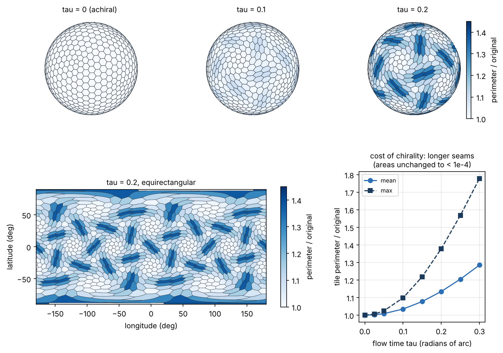

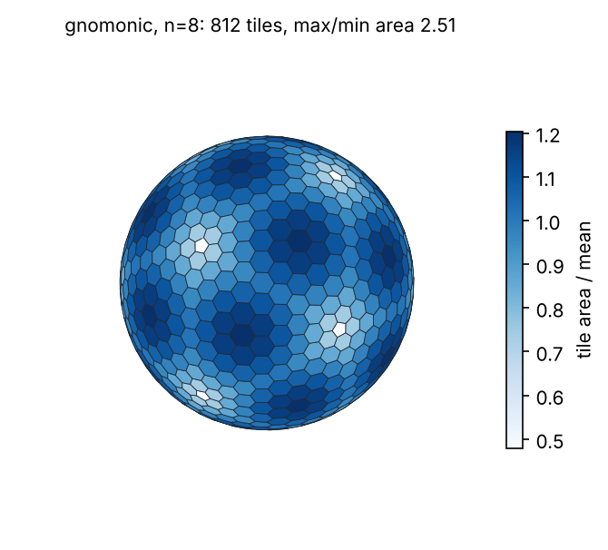


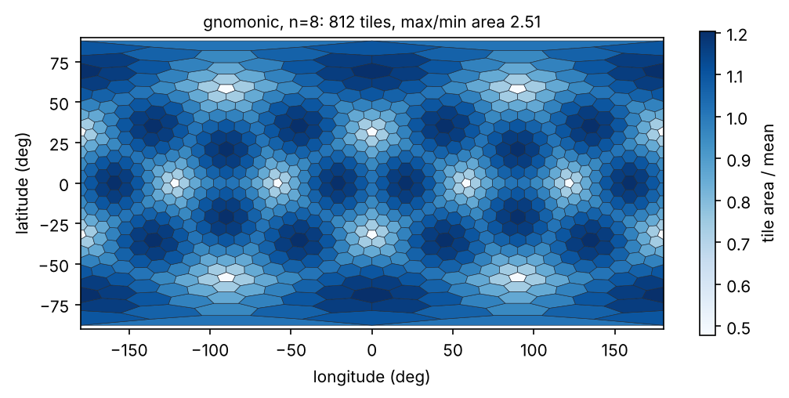

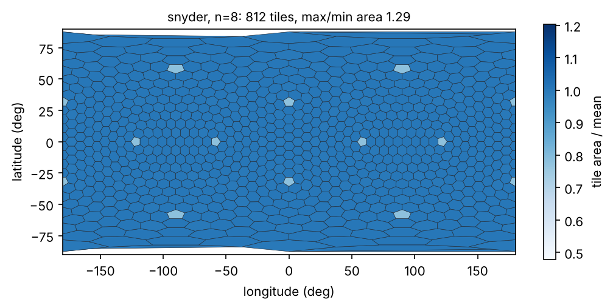


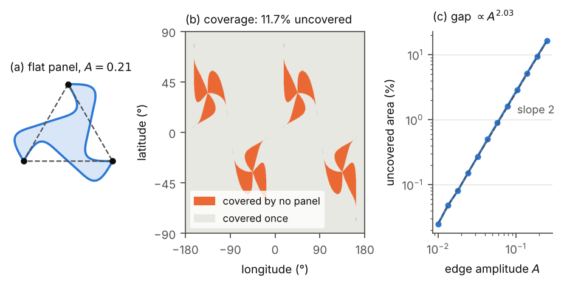


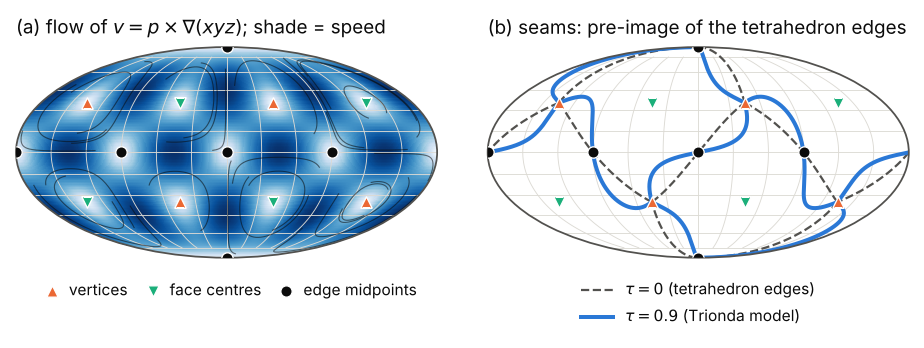

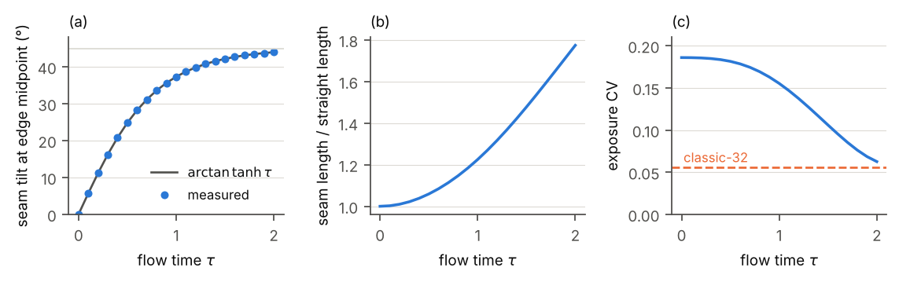

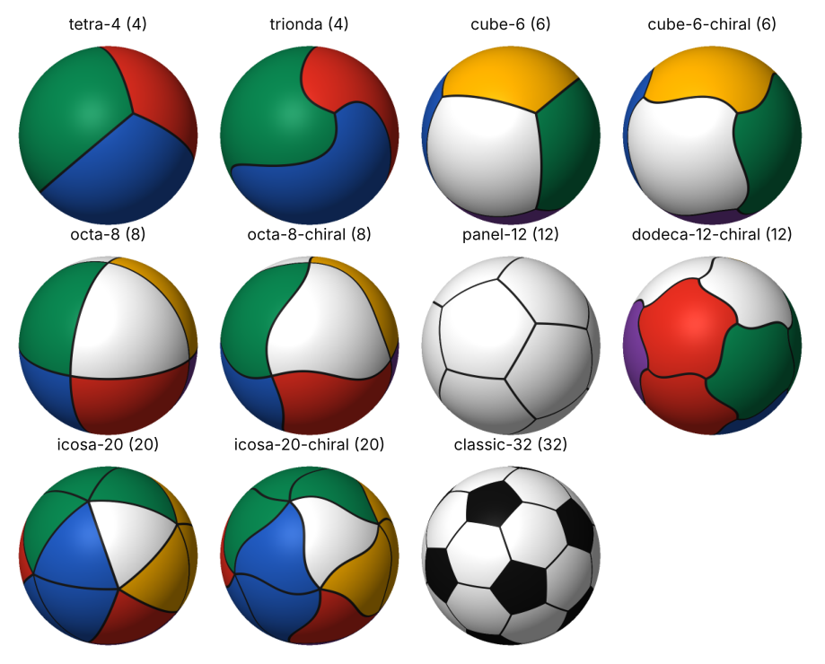


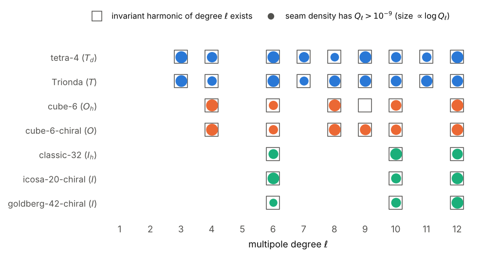


## Ball types, matplotlib plots

Panels are assigned per pixel from a polyhedron description (`balls.py`), so there is no flood fill, no leaking and uniform seam
width everywhere on the sphere. Needs only `numpy`, `pillow` and `matplotlib`.

```bash
python gen_ball.py --list                       # available ball types
python gen_ball.py panel-6 -s 2048 -o p6.png    # texture for any type (same convention as gen_texture.py)
python gen_ball.py classic-32 --pentagon-color blue --bg-color white --edge-color black
python gen_ball.py panel-20 --palette viridis   # every panel its own colour

python make_sprites_mpl.py panel-8 4 -s 128 -o sprites/p8       # sprite sheet, no PyVista
python make_sprites_mpl.py examples/b-and-w.png 4 -o sprites/b  # existing textures work too
python view_ball.py panel-14                    # interactive matplotlib viewer with sliders

python plot_ball.py geometry    panel-14 -o geo.png   # 3D panels + seams
python plot_ball.py projections classic-32 -o proj.png# equirectangular + Tissot circles, Mollweide, 2 views
python plot_ball.py analysis    panel-6  -o ana.png   # panel areas, seam density vs latitude, metrics
python plot_ball.py compare     -o cmp.png            # all types side by side
python plot_ball.py gallery     -o gallery.png
python ball_stats.py                                  # metrics table
python -m pytest tests
```

| Type | Layout |
|------|--------|
| `classic-32`, `-red`, `-retro` | truncated icosahedron, 12 pentagons + 20 hexagons |
| `panel-6` | 6 swirled panels (cube topology) |
| `panel-8` | 8 twisted panels (octahedron), two alternating colours |
| `panel-12` | 12 pentagons (dodecahedron) |
| `panel-14`, `panel-14-twist` | 6 squares + 8 hexagons (truncated octahedron) |
| `panel-20` | 20 swirled panels (icosahedron) |

The modern layouts are topological approximations (panel count and symmetry), not copies of any
manufacturer's template. The swirl is a rotation about an axis by an angle proportional to height
along it. It preserves panel area.

**Adding a ball type:** write a function in `balls.py` that returns `_ball(name, description, (normals,
heights, kinds), look, twist=...)` and decorate it with `@register`. Plots, sprites, textures and
statistics pick it up automatically.

**Statistics** are on the unit sphere. Seam length is exact (walks the real edge curves, twist included).
"Largest seam-free cap" is reported only for untwisted balls.

## Trionda model and the paper

`balls.py` also contains an exact model of a four-panel **chiral tetrahedral** ball (`trionda`) and chiral versions of the other
Platonic layouts. Panels are the pre-images of a straight partition under the flow of `p x grad f` for a rotation-group-invariant
`f` (here `xyz` for the tetrahedron), so the panels are congruent, equal in area and share their seams exactly.

```bash
python gen_ball.py trionda -s 2048 -o trionda.png
python make_sprites_mpl.py trionda 4 -s 128 -o sprites/trionda
python ball_metrics.py classic-32 tetra-4 trionda    # symmetry group, lowest multipole, exposure proxy
```

`trionda_barycentric.py` is the original barycentric edge-deformation script, kept unchanged. **It does not tile the sphere**:
with `amp=0.21, harmonic=0.035` about 11.7% of the sphere is covered by no panel (see `paper/`).

`paper/` holds the LaTeX paper. Every number and figure is generated by code:

```bash
cd paper
python make_data.py && python make_tables.py && python make_figures.py   # data/, tables/, figures/
latexmk -pdf trionda
```


## Technical Details

### Truncated Icosahedron Geometry

The soccer ball pattern is based on a truncated icosahedron, which has:
- 60 vertices
- 32 faces (12 pentagons + 20 hexagons)
- 90 edges

### Equirectangular Projection

The texture uses equirectangular projection (longitude/latitude mapping) which:
- Maps longitude to X-axis (0° to 360° → 0 to width)
- Maps latitude to Y-axis (90° to -90° → 0 to height)
- Requires distortion compensation near poles

### Great Circle Interpolation

Edge lines follow great circles (shortest paths on sphere) using:
- Spherical Linear Interpolation (SLERP)
- Haversine formula for distance calculation
- Configurable point density for quality vs. performance


## Folding the Spectre monotile (`spectre/`, `fold_spectre.py`)

Tile code is copied from brentharts/spectre-monotile-py (`spectre/tile.py`, `spectre/patch.py`).
`python fold_spectre.py -n 9 -n 25` folds a patch of N tiles by gluing boundary edges of the patch
(zips), keeping an exact integer angle ledger (all Spectre corners are multiples of 30 deg):
cone points have deficit 360 - angle, leftover boundary loops are holes with curvature
K = 360 + 180n - sum(tile angles at its corners). Discrete Gauss-Bonnet: sum(cone deficits) + sum(hole K) = 720
(asserted on every fold). Each hole records its boundary loop, side count and kind, K, and an
approximate spherical area / centre from a 3D relaxation (`spectre/embed.py`, ~2% rms edge strain).
The gluing is a heuristic beam search, not a proof of optimality; local zipping yields one hole per fold.

### Multi-hole folding (exact)

`spectre/dp.py` replaces the heuristic search with an exact interval DP over *all* non-crossing gluings of
a patch boundary (corner angles are multiples of 30 deg, so the state space is tiny).  `fold_with_holes(graph,
[theta1, theta2, ...])` returns a fold with holes whose corner angles (tile angle at each hole corner) are
exactly the given lists, or `None` when the boundary admits none; `[]` asks for a closed ball.  Each hole sits
inside its own glued pair, and the ledger (cone deficits + hole K = 720) is asserted on replay.

    python fold_spectre.py --hole square-alt --hole square-alt --nmin 8 --nmax 12   # two K=60 holes
    python fold_spectre.py --hole none --nmin 6 --nmax 10                           # closed balls

`spectre/search.py` draws random connected tile subsets (the tile set is the real lever); `spectre/connect.py`
gives hole signatures (corner angles + a/b edge kinds, up to rotation/reflection) and `join_vertices` to test
whether two holes can be glued edge to edge.  `spectre/holes_io.py` loads `holes.json`.
### Closed balls: patches that fold shut with no hole

The same DP answers whether the *whole* boundary can be glued shut (`can_close`, `fold_with_holes(graph, [])`).
Small random patches often can (89% of 4-tile, 45% of 6-tile, 20% of 8-tile patches), the rate falls to about 1% beyond
12 tiles, but closings still exist at 19-21 tiles.  Every closed ball has cone points whose angle deficits add to
exactly 720 deg (Gauss-Bonnet); most vertices are flat (deficit 0).

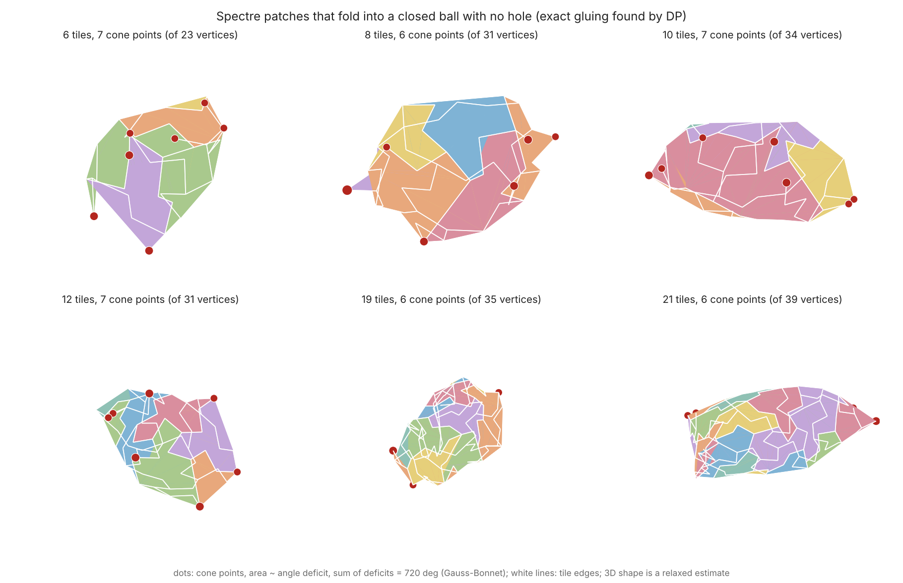

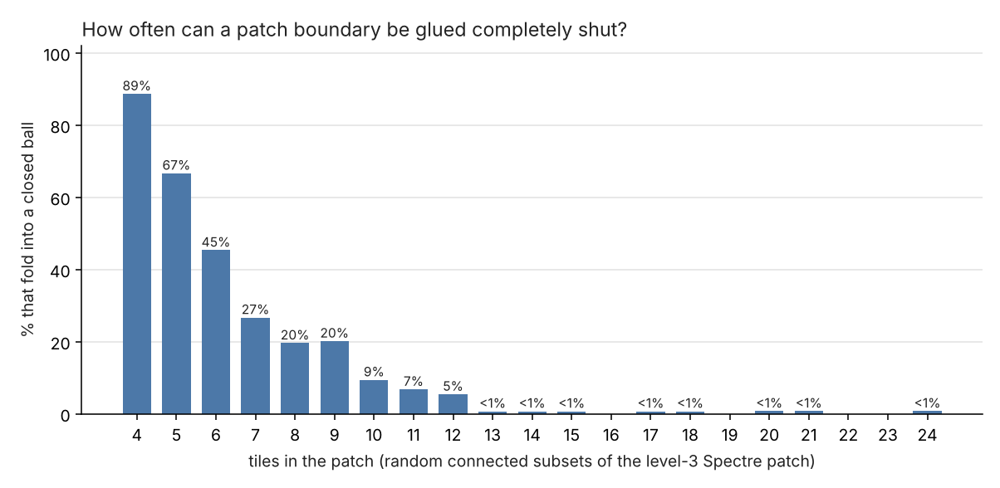

(150 random connected patches per size, drawn from the level-3 Spectre patch; 3D shapes are relaxed estimates.)

### Two spheres connected through their holes

`spectre.connect.join_spheres(a, i, b, j)` sews hole `i` of fold `a` to hole `j` of fold `b`: the boundaries run in
opposite directions, edge kinds are matched when possible, and at every joined vertex the two tile angles add up.
A sum below 360 leaves a cone point, a sum above 360 a saddle (negative curvature, a neck).  The ledger of the joined
surface (cone deficits + junction deficits + curvature of the remaining open holes) is asserted to be 720 deg.
The pictured pair joins two 4-gon holes (tile angles 240/270 deg on both sides), so the neck is a saddle with
deficits -120/-180 deg; each sphere keeps one open K=60 hole for the next connection.

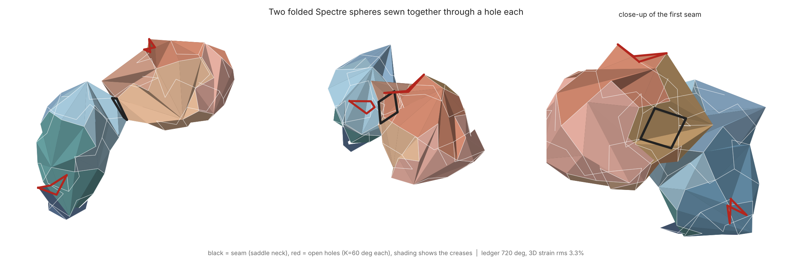

`join_many(parts, joins)` sews any number of folds (each hole is used once).  The ledger of the assembly is
asserted to be 720 deg x (parts - joins): 720 for a tree of spheres, 0 for a ring (a torus).  `embed_assembly`
places each child sphere against its parent's hole (twist and mirror chosen so the two rims coincide), merges the
seam vertices and relaxes the whole mesh with exact tile edge lengths plus a weak pull of every part towards its
own sphere (`sphere_weight`: higher is rounder, lower is more faithful; at 0.4 the rms edge strain is ~3%).
Faces are shaded by their normals so the creases show.

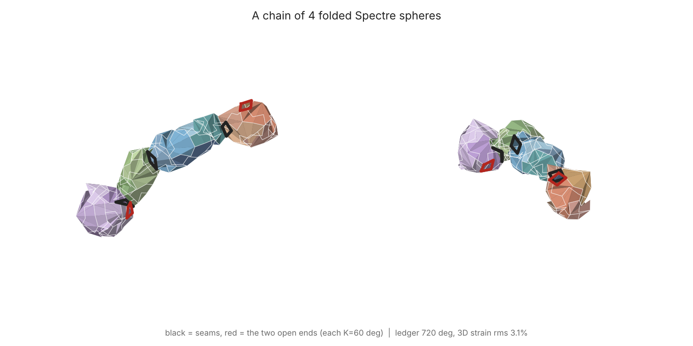

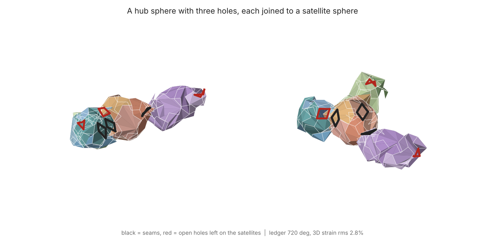

The star needs a fold with three square holes, which is rare (about 1 patch in 800 at 10 tiles; none with four holes
turned up in ~1400 patches).  A ring of four also joins correctly (ledger 0) but its closing seam comes out crumpled
in 3D (`python make_spectre_figures.py --only ring`), so no picture of it is shown here.

    python make_spectre_figures.py          # regenerates all figures above (survey cached in spectre/figures/survey.json)

Results (reproducible via `paper/make_spectre_data.py`, see `paper/data/spectre.json`): in a survey of 759 random disc patches
of 6-24 tiles, 92 admit a single K=60 square hole and 77 a pair of them; no regular hexagonal hole (K=0), no pentagon pair
and, in a second survey of 199 patches, no flat-fillable equilateral hexagon of any shape was found. The one-hole DP covers
every gluing (it runs on the doubled loop and equals brute force on one- and two-tile cases); with several holes it covers only
gluings where each hole lies inside a glued pair and no hole is nested in another, so the pentagon-pair result is for that class.
