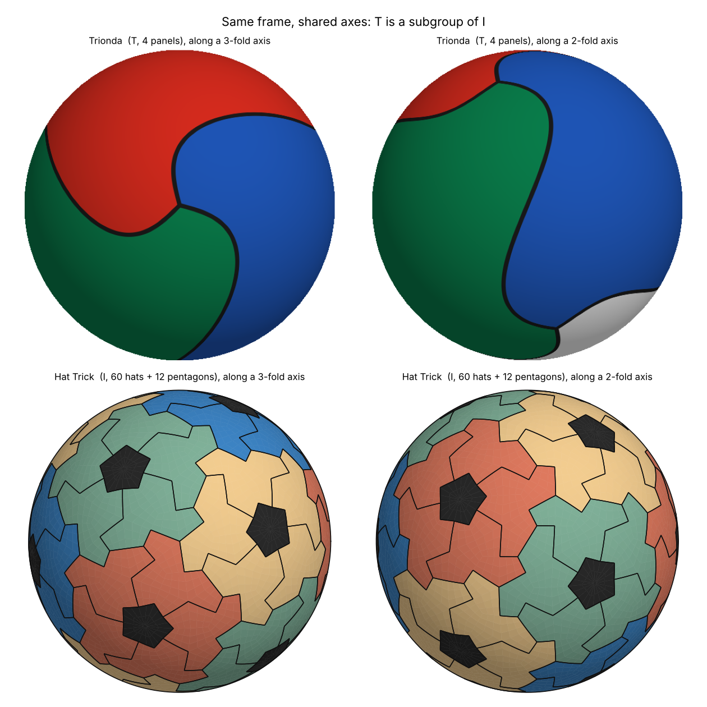
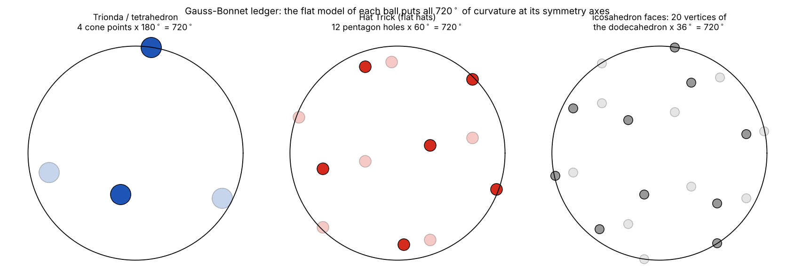
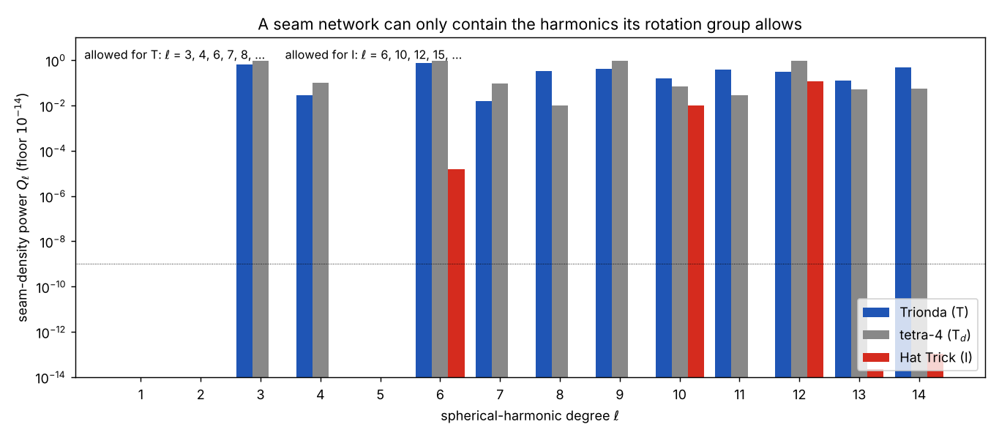
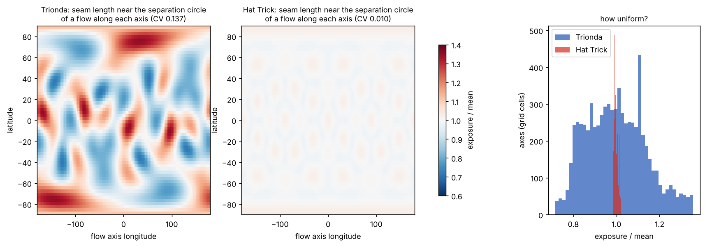
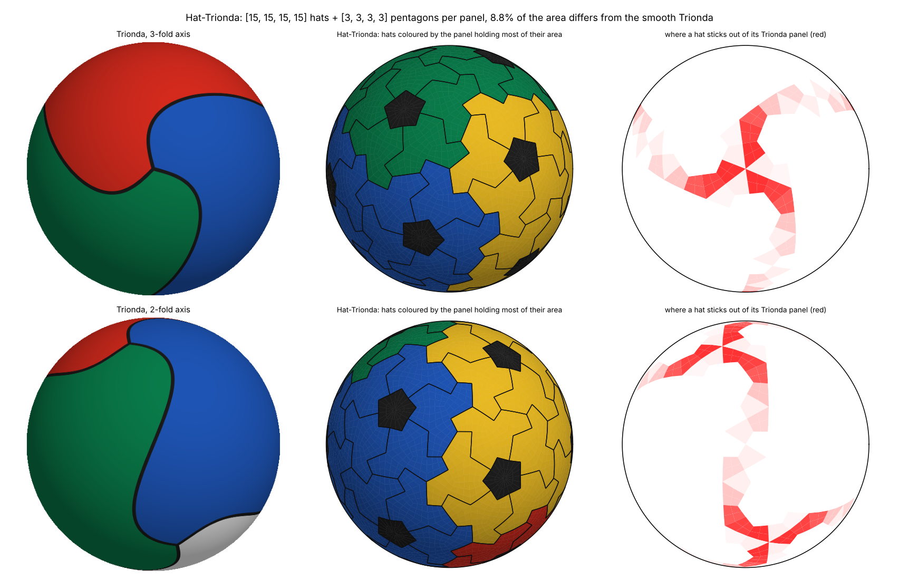
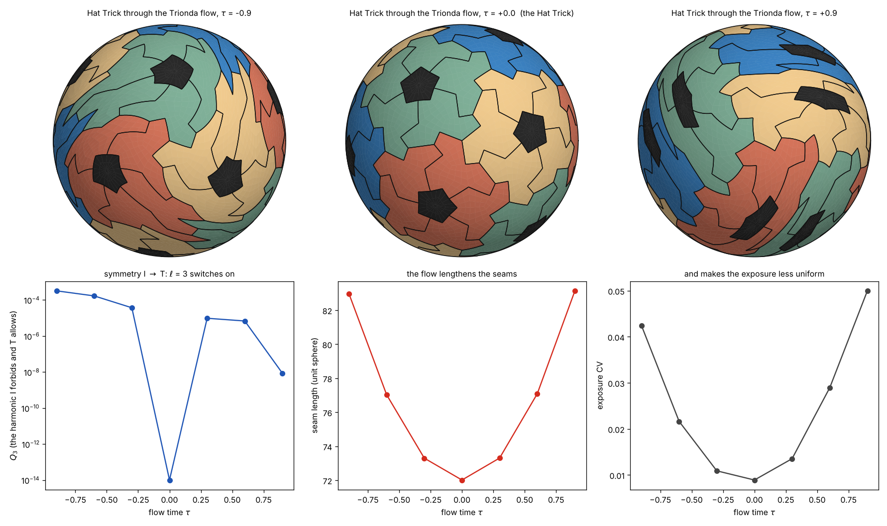

# The Trionda and the Hat Trick: what they have in common

Two very different balls: the **Trionda** has 4 big smooth swirling panels, and
the **Hat Trick** has 72 small panels (60 aperiodic "hat" tiles and 12 pentagons).
This note collects the math connections between them, figures to look at, and two
ways of blending them. Everything here is produced by
[`compare_trionda_hat.py`](compare_trionda_hat.py) (run `python compare_trionda_hat.py`;
`--only {table,chirality,views,spectra,exposure,assign,flow,ledger}` runs one stage).
The balls themselves come from [`balls.py`](balls.py) (Trionda) and
[`the_hat_trick_ball.py`](the_hat_trick_ball.py) (Hat Trick).

Both balls are drawn in the same frame, looking down a shared 3-fold axis (top)
and a shared 2-fold axis (bottom).

## At a glance

| | Trionda | Hat Trick (variant 0) |
|---|---|---|
| Panels | 4 | 72 (60 hats + 12 pentagons) |
| Rotation group | T, order 12 | I, order 60 |
| Seam length (unit sphere) | 13.57 | 72.02 |
| Lowest seam harmonic ℓ | 3 | 6 |
| Exposure CV (see below) | 0.163 | 0.0089 |
| Curvature at the axes | 4 × 180° | 12 × 60° |

## Math connections

* **Shared symmetry.** The Trionda has tetrahedral symmetry T (order 12), which sits
  inside the Hat Trick's icosahedral symmetry I (order 60). A regular tetrahedron's
  four vertices are 3-fold axes of the icosahedron, so the two balls can share a frame,
  their 3-fold axes and their 2-fold axes.
* **Counts.** The Trionda has 4 panels and the Hat Trick has 72 (60 hats plus 12
  pentagons). T acts freely on both the 12 pentagons and the 60 hats, so one orbit of 12
  splits into 4 groups of 3 (and the 60 hats into 5 orbits of 12).
* **Curvature.** In a flat model of each ball, all 720° of curvature sits on its symmetry
  axes. The Trionda has 4 points of 180°, and the Hat Trick has 12 pentagon holes of 60°
  each (the hats give 240° at each pentagon corner, so each hole carries 60°).
* **Selection rules.** I allows only the seam harmonics ℓ = 0, 6, 10, 12, 15, …, while T
  also allows ℓ = 3, 4, 7, 8, 9, 11, …. The Trionda's lowest harmonic is ℓ = 3 and the
  Hat Trick's is ℓ = 6. The spectra figure shows this directly.
* **Chirality.** The measured distance from each seam network to its own mirror image is
  about 0.0° for the achiral tetra-4 ball, 6.8°, 11.5° and 10.1° for the Trionda at
  τ = 0.3, 0.6 and 0.9, 1.0° and 1.7° for Hat Trick variants 0 and 1, and 2.5° for the
  chiral Goldberg-42.
  * Hat Trick variant 0 is nearly mirror-symmetric as a seam network even though each hat
    is chiral. I haven't checked why.

### Curvature ledger

A sphere carries 720° of curvature (4π, counted in degrees of angle deficit). In the
flat model of each ball, that total is concentrated on the symmetry axes. For the
Trionda it sits on the 4 tetrahedron vertices (180° each), and for the Hat Trick it
sits on the 12 pentagon centres (60° each). The third panel is the same bookkeeping for
the 20 faces of an icosahedron (36° each) for reference.

### Selection rules

The bars show the power of each spherical harmonic in the seam network. The
Hat Trick has nothing at ℓ = 3 or 4, because I forbids them, while the Trionda (and the
tetrahedron) use them. The Hat Trick's ℓ = 6 power is about 1.6e-5 rather than exactly
zero, which comes from the strain of my relaxed reconstruction, not from the symmetry.

### Exposure

"Exposure" is the length of seam near the separation circle of a flow along a given
axis, which is a proxy for how much the seams show up whatever way the ball is spun. The
Hat Trick is almost uniform, and the Trionda varies strongly with axis. The maps use a
regular longitude/latitude grid of axes, so their CVs (0.137 and 0.010) differ from the
table's (0.163 and 0.0089), which sample random axes.

## Blending them

### 1. Hat-Trionda: assign hats to Trionda panels

Each hat and pentagon goes to the Trionda panel that holds most of its area. Because T
acts freely on the hats and pentagons, the assignment is T-equivariant and every panel
gets exactly **15 hats + 3 pentagons**. The seams between the four hat clusters total
16.06, and about 8.8% of the area differs from the smooth Trionda. 48 of the 60 hats
straddle a panel boundary, with the worst hat having 78.5% of its area in its assigned
panel. The red map shows where hats stick out of their panel.

### 2. Flow blend: push the Hat Trick through the Trionda flow

The Trionda is the flow of a rotated gradient field. Applying that flow to the Hat Trick
for time τ (the Trionda uses τ = 0.9) breaks I down to T. ℓ = 3 and ℓ = 4 switch on,
seam length grows from 72 to about 83, and exposure CV grows from 0.009 to about 0.05.

| τ | −0.9 | −0.6 | −0.3 | 0 | 0.3 | 0.6 | 0.9 |
|---|---|---|---|---|---|---|---|
| Seam length | 82.96 | 77.03 | 73.30 | 72.02 | 73.31 | 77.09 | 83.14 |
| Exposure CV | 0.042 | 0.022 | 0.011 | 0.009 | 0.014 | 0.029 | 0.050 |

## Caveats

* The Hat Trick here is my reconstruction of the design: 60 hats on the 92-tile
  geodesic sphere, relaxed on the sphere with rms strain of 2.1% (max 5.3%). Real balls
  would differ in detail.
* Q₃ along the flow sweep is not monotonic (about 1e-8 at τ = 0.9 but about 1e-5 at
  τ = 0.3), so I would not read a trend into it. ℓ = 3 and 4 are small in absolute terms
  because the warp moves the seams only slightly.
* Hat-Trionda assigns whole hats by majority area. It is a blend of the topology, not a
  smooth interpolation.
* The chirality numbers are a mean seam-to-mirror-seam distance, so they depend on the
  sampling and on which improper symmetries are tried (cube group for T, inversion times I
  for the Hat Trick).

## Things to try next

* Pick the hat tiling and placement that lie best inside the Trionda panels, instead of
  using majority area.
* Find out why Hat Trick variant 0 is nearly mirror-symmetric as a seam network.
* Extend the frequency scan of the Hat Trick to GP(m, n) with n > 0.
* Try other warps between the two balls.
